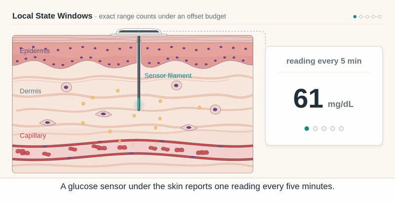
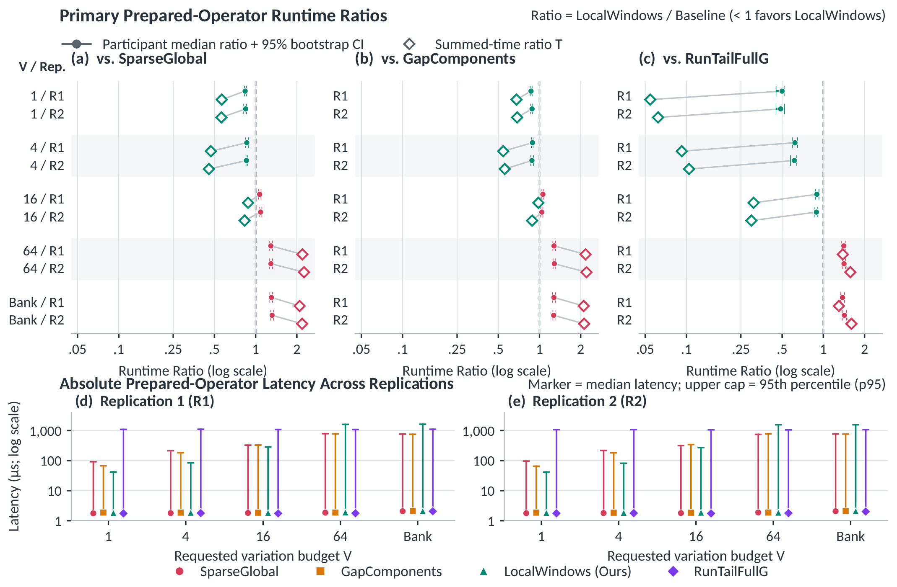

<div align="center">

# Exact Range-Count Envelopes<br>Over Ordered Time Series<br>Under Total-Variation Drift Budgets

<p><a href="mailto:zijia.wang18@imperial.ac.uk">Zijia Wang</a> · <a href="mailto:c.toumazou@imperial.ac.uk">Christofer Toumazou</a></p>

Centre for Bio-Inspired Technology, Department of Electrical and Electronic Engineering<br>
Imperial College London, London, United Kingdom

**One time series. One total-variation drift budget. Exact count envelopes.**

[Paper](docs/assets/paper.pdf) · [Project page](https://oliverdou776.github.io/Exact-Temporal-Range-Queries-through-Local-State-Windows/) · [Try your data](https://oliverdou776.github.io/Exact-Temporal-Range-Queries-through-Local-State-Windows/demo/) · [Run the code](#quick-start) · [Method](#method) · [Results](#results) · [BibTeX](#citation)

</div>

<p align="center"><a href="https://oliverdou776.github.io/Exact-Temporal-Range-Queries-through-Local-State-Windows/"></a></p>

<p align="center"><sub>96 public BIG001 glucose readings, one per well. As recorded, 84 lie in the TITR band [70,140] mg/dL; over every integer offset path in −30…30 with total variation at most 4, the count is at least 63 and at most 92. The film subtracts offsets (g<sub>i</sub> − x<sub>i</sub>), as the browser tool does; on this symmetric domain that is the paper's g<sub>i</sub> + δ<sub>i</sub> model with x<sub>i</sub> = −δ<sub>i</sub>. Skin, sensor and plate are schematic; the trace, offset paths and counts are computed from the data (<a href="docs/figures.md#project-page-opening-film">details</a>, <a href="docs/project/opening-film.mp4">MP4</a>).</sub></p>

Threshold-count and range-proportion queries, such as time in range (TIR) and time in tight range (TITR) for continuous glucose monitoring (CGM), are usually evaluated on the readings as recorded. Calibration bias and drift, however, perturb a sensor smoothly over time. **LocalWindows** is an exact query operator that returns the minimum and maximum attainable threshold counts when every reading may be shifted by an integer offset and consecutive offsets share a total-variation (TV) budget, for a whole bank of budgets at once. This repository contains a Python implementation, a native C++ driver with the paper's exact baselines, an in-browser query tool and the paper.

## Run an exact query

**[Try your own data →](https://oliverdou776.github.io/Exact-Temporal-Range-Queries-through-Local-State-Windows/demo/)**

The browser tool lets you:

1. **Paste readings or upload a CSV**, with optional 0/1 row weights.
2. **Set the band, integer offset domain and shared movement (total-variation) budgets.**
3. **Compute exact minimum and maximum counts**, then download the result as JSON.

It supports exact decimal predicates, up to **2,000 rows**, **401 integer states**, and budgets **0–64**. Inputs stay in your browser, with no external upload. [Input format and worked walkthrough](docs/demo.md) · [Video/GIF guide](docs/demos/README.md)

Check the browser solver independently with `node tests/test_browser_solver.cjs` (320 exhaustive small cases plus fixed public and decimal-boundary checks; no dependencies).

<p align="center"><a href="https://oliverdou776.github.io/Exact-Temporal-Range-Queries-through-Local-State-Windows/demo/"></a></p>

## Using the browser tool

These screen recordings show the browser application in use: entering data, changing a query, inspecting exact counts and downloading the query with its results. Each session demonstrates a complete task.

| Task | What the session shows | Recording |
|:--|:--|:--|
| **Paste data, compute and export** | Paste two readings, compute budgets 0 and 1, edit a reading, recompute and download JSON. | [MP4](docs/demos/csv-session.mp4) · [GIF](docs/demos/csv-session.gif) |
| **Check a public glucose report** | Load 96 public BIG001 readings, inspect five budgets, narrow the allowed offsets and export the revised report. | [MP4](docs/demos/public-session.mp4) · [GIF](docs/demos/public-session.gif) |
| **Report selected readings** | Import a five-row CSV with a 0/1 count mask, keep temporal order, add a budget and export. | [MP4](docs/demos/masked-session.mp4) · [GIF](docs/demos/masked-session.gif) |

[Session steps, example files and data attribution](docs/demos/README.md).

## Two readings explain the problem

Take readings **70 and 141 mg/dL**. Count how many corrected readings fall in the closed band **[70,140]**. In the browser tool and the Python API, **corrected reading = glucose − offset**; here each offset is 0 or 1.

- **Budget 0:** either constant offset gives exactly **one hit → [1,1]**.
- **Budget 1:** offsets **(0,1)** give two hits; **(1,0)** give zero → **[0,2]**.

The budget limits **total movement across the sequence**. It is shared by all rows. Zero movement permits any constant offset in the domain. The paper writes the same model as a perturbed reading $g_i+\delta_i$; subtracting $x_i=-\delta_i$ is that model with the offset domain reflected, so on a symmetric domain $\{-R,\ldots,R\}$ both forms give identical envelopes.

## The same query on real observations

The paper's running example is public record **BIG001**: **96 samples**, offsets $\delta_i\in\{-30,\ldots,30\}$, and the closed TITR band **[70,140] mg/dL**. As recorded, **84/96** readings are in range. Treating every row's offset independently gives the vacuous interval **[33,96]** (width 63). Under a TV budget $V=4$ the exact envelope is **[63,92] out of 96** (65.6%–95.8%), 54.0% narrower. On this record 33 rows are always-hit, and the 63 active rows merge into $r=56$ runs.

These are **exact extrema, not confidence intervals**. Separate metrics may attain their extrema on different paths. The offset radius and drift budget are user-specified query parameters; the operator does not fit them to sensor data. [Explore the example interactively →](https://oliverdou776.github.io/Exact-Temporal-Range-Queries-through-Local-State-Windows/#example)

**Results in brief:** across **6,804** query cells per request mode on **211** public CGM series, LocalWindows agrees bit for bit with three exact DP baselines (SparseGlobal, GapComponents, RunTailFullG) and lowers prepared-operator runtime at $V\in\{1,4\}$ (participant-median ratios **0.488–0.889**; $p\le5.7\times10^{-37}$ at $V=1$ and $p\le3.2\times10^{-36}$ at $V=4$). On the 3,798 non-static cells its median speedups over SparseGlobal are **3.03×** ($V=1$) and **1.72×** ($V=4$); on 1,152-sample horizons the summed-time speedup reaches **10.2×**. At $V\ge16$, where the windows approach the full offset grid, the global baselines regain the advantage. [Full results below.](#results)

## What this solves

Let $g=(g_1,\ldots,g_n)$ be an ordered series and $[L,U]$ a threshold band (two-sided or one-sided). Each reading is perturbed by an integer offset $\delta_i\in D=\{-R,\ldots,R\}$, $m=|D|=2R+1$, and consecutive offsets share a total-variation budget:

$$
\operatorname{TV}(\delta)=\sum_{i=2}^{n}|\delta_i-\delta_{i-1}|\le v,\qquad
C(\delta)=\sum_{i=1}^{n}\mathbf{1}\{L\le g_i+\delta_i\le U\}.
$$

For every budget $v$ in an ordered bank $\mathcal{V}=\{v_1<\cdots<v_K\}$, LocalWindows returns the exact envelope $[\operatorname{lo}(v),\operatorname{hi}(v)]$ of $C(\delta)$ over all feasible trajectories, together with the range-proportion interval $[100\,\operatorname{lo}(v)/n,\ 100\,\operatorname{hi}(v)/n]$. At $v=0$ every constant shift is allowed; the envelope widens monotonically with $v$ and saturates at the independent per-sample bounds once $v\ge2R(n-1)$.

This repository's implementations solve the same problem in a slightly more general form: any consecutive integer domain $\{a,\ldots,b\}$, the reading-minus-offset convention above, open or closed decimal band endpoints, and nonnegative row weights (weight 0 masks a row without resetting the shared budget). [Formulation and implementation contract](docs/method.md)

## Quick start

Python 3.10+; the Python package uses the standard library.

```bash
python -m pip install -e .
python -m lsw_range examples/synthetic.json
```

```python
from lsw_range import solve_intervals

# The four weighted runs in the mechanism figure: (lower, upper, weight).
answer = solve_intervals(
    [(2, 6, 2), (7, 13, 1), (4, 19, 3), (10, 17, 2)],
    domain=(0, 23),
    budgets=[4],
)
print(answer.bounds)  # ((0, 8),)
```

For measured observations, `solve_glucose` compiles a glucose band to exact hit-offset intervals before solving.

The native C++17 path accepts unit-count rows. This synthetic example expands the mechanism figure's integer weights into repeated unit rows:

```bash
mkdir -p build
c++ -std=c++17 -O3 native/lsw_range.cpp -o build/lsw-native
build/lsw-native < examples/synthetic_native.txt
```

The JSON CLI demo and native demo return bounds `[[0,6], [0,6], [0,8]]` for budgets `[0,1,4]`. [API & examples](docs/api.md) · [Native input protocol](docs/native.md) · [Implementation provenance](docs/provenance.md)

In Python, use `method="global"` or `method="gap"` to compare exact global-grid and gap-split plans, and `method="reference"` as a small-case literal-state correctness oracle. The native driver also exposes the paper's three baselines (`GlobalBudgetBank` = SparseGlobal, `GapComponents`, `RunTailFullGThenGather` = RunTailFullG) and the `LocalWindowsGeneric` ablation. The local plan is intended for small and moderate maximum budgets; this release does not provide an automatic plan selector.

## Method

LocalWindows has three stages; lemma and theorem numbers refer to [the paper](docs/assets/paper.pdf).

1. **Extrema-preserving run reduction.** Always-hit ($I_i=D$) and always-miss ($I_i=\emptyset$) rows contract into scalar constants $c_1,c_0$ (**Lemma 1, fixed-row contraction**), and adjacent identical offset intervals merge into $r$ positive-weight runs (**Theorem 1, duplicate-run merging**). Neither step changes any budget-constrained minimum or maximum. A single $O(r+m)$ difference-array sweep then gives the static depth $d(z)$ and the exact $V=0$ envelope.
2. **Overlapping $2V$-state window cover.** A trajectory with $\operatorname{TV}\le V$ has range diameter at most $V$, so overlapping windows $W_j=B_j\cup B_{j+1}$ built from adjacent blocks of the offset grid contain every feasible trajectory (**Lemma 2**). Relative to a window, each run is a disjoint miss, a covered hit, or an active boundary run. Each run is active in at most four windows, so there are **at most $4r$ run–window incidences** in total (**Lemma 3**), and covered runs fold into an $O(1)$ static-depth baseline read from $d(z)$.
3. **Linear-time local sweeps.** Each active window runs a two-pass $O(|W_j|)$ state-line transition kernel up to a local saturation cap shared by the whole budget bank (**Proposition 1**). For unit drift, an **$O(r+m)$ boundary-prefix fast path** evaluates only single steps at run boundaries and needs no DP table (**Proposition 2**).

**Exactness and complexity (Theorem 2).** Run compression and the static $V=0$ evaluation take $O(n+m)$ time. For $V=1$ the boundary-prefix fast path takes $O(r+m)$ time and $O(m)$ space. For $V\ge2$ the local DP performs at most

$$
\sum_{j\in\mathcal{A}}|R_j|\,(B_j+1)\,|W_j|\;\le\;4r(V+1)(2V+1)
$$

inner-loop state updates: $O(rV^2+m)$ time and $O(V^2+m)$ working memory when $V\ll m$, and $O(rVm)$ in the worst case when $V=\Omega(m)$. Relative to global run-compressed DP, the work ratio is $\rho(V)\le4(2V+1)/m$, so the advantage fades as $2V+1$ approaches $m$; this is the crossover seen at $V\ge16$ on $m=61$.

The repository's Python and browser solvers use blocks of $V$ states, so each window has at most $2V$ states, and by default they restrict each window to its critical offsets. [Full formulation, implementation contract and limits](docs/method.md)

<details>
<summary><strong>Mechanism figure and two more teaching examples</strong></summary>

<p align="center">

</p>

A mathematical example computed with this repository's solver: $D=\{0,\ldots,23\}$, $V=4$, four weighted runs, windows of at most $2V=8$ states and twelve active run–window incidences ($\le4r=16$). Restoring the covered-run baseline in window $W_2=[8,15]$ turns its local envelope $[1,3]$ into $[4,6]$; reducing all local and static extrema gives the global envelope $[0,8]$.

Both teaching examples below use the closed band **[70,140] mg/dL**, corrected value **glucose − offset**, and offsets **0 or 1**.

| Example | Budget | Exact count bounds | Why |
|:--|:--|:--|:--|
| One reading: **141** | 0 | **[0,1]** | Offset 0 leaves 141 outside; offset 1 gives 140 inside. |
| Mask the middle: **70,100,141**, weights **1,0,1** | **0 → 1** | **[1,1] → [0,2]** | The middle row adds no count; the retained rows still share one budget. |

These and the opening two-reading example are fully specified synthetic teaching cases. The BIG001 demo uses public observations.

</details>

## Results

<p align="center">

</p>

**211 public CGM series · 6,804 query cells per request mode · two independent replications (R1, R2).** The series come from the PhysioNet BIG IDEAs cohort (16 participants) and the Shanghai diabetes CGM cohort (195 patient series). Each cell is an $n=96$ window evaluated for one of six consensus predicates (TIR, TITR, TBR70, TBR54, TAR180, TAR250) and one offset radius $R\in\{15,30,120\}$ mg/dL ($m\in\{31,61,241\}$), in five request modes: single budgets $V\in\{1,4,16,64\}$ and the ordered bank $\{0,1,4,16,64\}$. All four operators agree bit for bit on every count and percentage (**0/68,040** primary cell comparisons mismatched).

| Budget $V$ | LocalWindows / SparseGlobal | LocalWindows / GapComponents | LocalWindows / RunTailFullG | Regime |
|:--|--:|--:|--:|:--|
| 1 | 0.838–0.846 (*T* 0.562–0.565) | 0.867–0.882 (*T* 0.679–0.686) | 0.488–0.499 (*T* 0.054–0.062) | Unit drift: faster than all baselines, $p\le5.7\times10^{-37}$ |
| 4 | 0.856–0.861 (*T* 0.456–0.471) | 0.880–0.889 (*T* 0.543–0.557) | 0.614–0.620 (*T* 0.092–0.104) | Moderate drift: faster than all baselines, $p\le3.2\times10^{-36}$ |
| 16 | 1.069–1.086 (*T* 0.830–0.880) | 1.040–1.058 (*T* 0.883–0.981) | 0.890–0.898 (*T* 0.298–0.309) | Transition: medians favor SparseGlobal and GapComponents; *T* and the RunTailFullG comparison favor LocalWindows |
| 64 | 1.291–1.293 (*T* 2.194–2.256) | 1.276–1.283 (*T* 2.169–2.203) | 1.411–1.416 (*T* 1.387–1.574) | Dense: baselines faster |
| Bank: 0, 1, 4, 16, 64 | 1.305–1.319 (*T* 2.095–2.185) | 1.269–1.275 (*T* 2.102–2.118) | 1.381–1.424 (*T* 1.298–1.604) | Dense: baselines faster |

Entries are the **participant-level median geometric-mean runtime ratio** (LocalWindows/baseline), shown as the range over replications R1 and R2, followed by the summed-time ratio $T=\sum_c t_\text{local}(c)/\sum_c t_\text{base}(c)$. Below one favors LocalWindows. The paper's Table II gives each replication with its 95% participant-bootstrap interval (2,000 resamples); [all values are transcribed here](docs/benchmarks.md#primary-prepared-operator-runtime-table-ii). At $V=1$, LocalWindows totals **69.33 / 70.56 ms** over the 6,804 cells in R1 / R2.

**Why it is faster.** On the 3,798 non-static cells ($r\ge1$; median $r=24$ runs from $n=96$), the $V=1$ fast path performs no DP state updates and reaches a median runtime ratio of **0.330 (3.03×)** against SparseGlobal and 0.336 (2.98×) against GapComponents, with a 100% participant win rate. At $V=4$ a median of 4 active windows cuts inner-loop DP updates to $\rho(4)=0.340$, for a median ratio of **0.583 (1.72×)** and 0.601 (1.66×). The incidences per run never exceed the ceiling of 4 in any cell (0/3,798 violations). Widening the offset grid helps: at $V=4$ the median speedup over SparseGlobal grows from 1.07× ($R=15$) to 1.72× ($R=30$) and 2.26× ($R=120$).

**Longer horizons.** Summed-time ratio LocalWindows/SparseGlobal (R1 / R2), Table IV of the paper:

| Budget | $n=96$ (1 day) | $n=288$ (3 days) | $n=576$ (6 days) | $n=1{,}152$ (12 days) |
|:--|--:|--:|--:|--:|
| $V=1$ | 0.310 / 0.317 | 0.172 / 0.175 | 0.130 / 0.131 | 0.101 / 0.096 |
| $V=4$ | 0.332 / 0.340 | 0.203 / 0.224 | 0.181 / 0.180 | 0.163 / 0.177 |
| $V=16$ | 0.827 / 0.804 | 0.626 / 0.622 | 0.586 / 0.583 | 0.546 / 0.574 |

At $V=1$ the summed-time speedup grows from 3.19× to **10.15×**; at $V=16$ the share of cells where LocalWindows is slower than SparseGlobal falls from 35.4% to 10.0%. Without the boundary-prefix fast path, window localization alone gives 2.72×–8.26× over SparseGlobal; the fast path adds a further 18%–23%.

**Scope.** These are the paper's prepared-operator timings of C++20 implementations (g++ -O3) that share parsing, interval compilation and 64-bit integer arithmetic. In a cold, uncached source-to-report pipeline, file I/O and parsing (30–75 ms per 18-cell report) dominate the prepared operator (0.05–2.5 ms), and most 95% intervals on end-to-end report time span 1.0. The numbers above are not timings of this repository's Python package, native driver or browser tool. [All tables, estimators and protocol →](docs/benchmarks.md)

<details>
<summary><strong>BIG001 figure and data attribution</strong></summary>

<p align="center">

</p>

For public record **BIG001**, $n=96$, $D=\{-30,\ldots,30\}$, and the closed TITR band is $[70,140]$ mg/dL. The envelopes in this figure were computed with this repository's solver (in its reading-minus-offset form, which gives the same envelopes on this symmetric domain); the browser tool and the Python reference oracle return the same values. At budget $V=4$ the exact envelope is **[63,92] out of 96**. At budget zero, every constant offset in the domain is allowed.

The plotted data are from BIG IDEAs Lab Glycemic Variability and Wearable Device Data, version **1.1.3**; [attribution and figure details](docs/figures.md) accompany the artwork. The optional [BIG001 verifier](examples/verify_big001.py) takes a user-supplied official CSV; see the [verification command](docs/api.md#optional-fixed-big001-example).

</details>

## Citation

```bibtex
@misc{wang2026rangecount,
  title  = {Exact Range-Count Envelopes Over Ordered Time Series Under Total-Variation Drift Budgets},
  author = {Wang, Zijia and Toumazou, Christofer},
  year   = {2026},
  url    = {https://github.com/OliverDOU776/Exact-Temporal-Range-Queries-through-Local-State-Windows}
}
```

The paper is included as [docs/assets/paper.pdf](docs/assets/paper.pdf). [CITATION.cff](CITATION.cff) carries the same reference.

## Attribution

Software and manuscript: Zijia Wang and Christofer Toumazou, Centre for Bio-Inspired Technology, Department of Electrical and Electronic Engineering, Imperial College London. The [project page](https://oliverdou776.github.io/Exact-Temporal-Range-Queries-through-Local-State-Windows/) starts with worked examples and includes the browser query tool, the BIG001 example, the paper's results and runnable code.

The paper's evaluation uses [BIG IDEAs Lab data v1.1.3](https://doi.org/10.13026/aw6y-fc44) and [Shanghai diabetes datasets v5](https://doi.org/10.6084/m9.figshare.21600933.v5). The clinical thresholds follow the international consensus on time in range (Battelino et al., *Diabetes Care* 42(8), 2019). Retain the third-party attribution and applicable licenses when reusing data or derived figures. See [figure provenance](docs/figures.md) and the [third-party notices](NOTICE).
