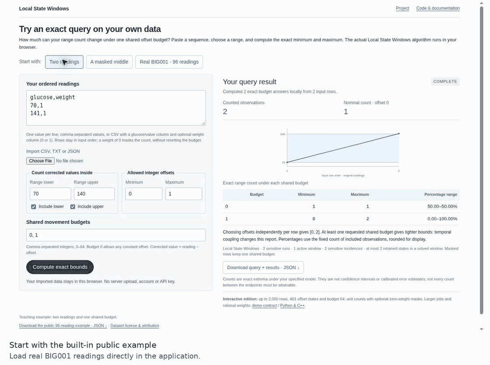
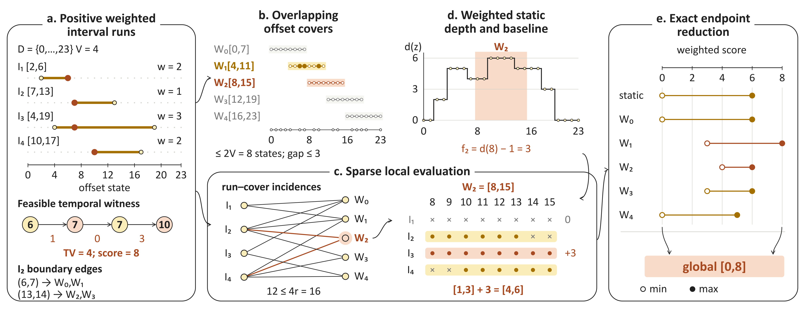
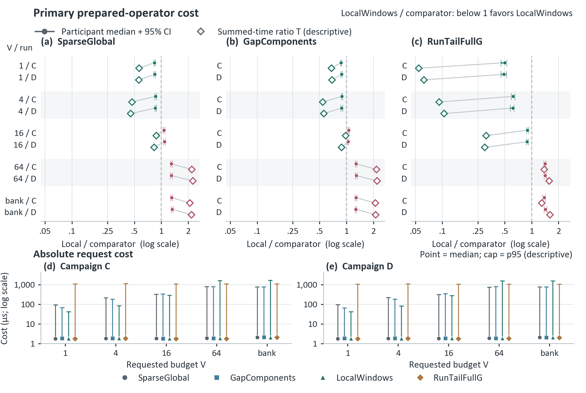
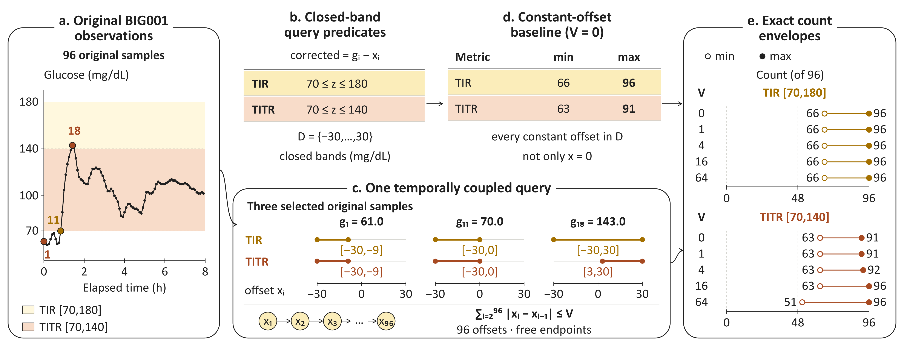

<div align="center">

# Local State Windows

### Exact Temporal Range Queries<br>Without Full-Domain Enumeration

**Zijia Wang · Christofer Toumazou**  
Imperial College London

**One sequence. One movement budget. Exact count bounds.**

[Project](https://oliverdou776.github.io/Exact-Temporal-Range-Queries-through-Local-State-Windows/) · [Run the code](#quick-start) · [Method](#why-local-windows-work) · [Results](#measured-results-and-the-crossover) · [Query contract](docs/method.md)

</div>

## Run an exact query

**[Try your own data →](https://oliverdou776.github.io/Exact-Temporal-Range-Queries-through-Local-State-Windows/demo/)**

The browser tool lets you:

1. **Paste readings or upload a CSV**, with optional 0/1 row weights.
2. **Set the band, integer offset domain and shared movement budgets.**
3. **Compute exact minimum and maximum counts**, then download the result as JSON.

It supports exact decimal predicates, up to **2,000 rows**, **401 integer states**, and budgets **0–64**. Inputs stay in your browser, with no external upload. [Input format and worked walkthrough](docs/demo.md) · [Video/GIF guide](docs/demos/README.md)

Check the browser solver independently with `node tests/test_browser_solver.cjs` (320 exhaustive small cases plus fixed public and decimal-boundary checks; no dependencies).

<p align="center"><a href="https://oliverdou776.github.io/Exact-Temporal-Range-Queries-through-Local-State-Windows/demo/"></a></p>

## Using Local State Windows

These screen recordings show the browser application in use: entering data, changing a query, inspecting exact counts and downloading the query with its results. Each session demonstrates a complete task.

| Task | What the session shows | Recording |
|:--|:--|:--|
| **Paste data, compute and export** | Paste two readings, compute budgets 0 and 1, edit a reading, recompute and download JSON. | [MP4](docs/demos/csv-session.mp4) · [GIF](docs/demos/csv-session.gif) |
| **Check a public glucose report** | Load 96 public BIG001 readings, inspect five budgets, narrow the allowed offsets and export the revised report. | [MP4](docs/demos/public-session.mp4) · [GIF](docs/demos/public-session.gif) |
| **Report selected readings** | Import a five-row CSV with a 0/1 count mask, keep temporal order, add a budget and export. | [MP4](docs/demos/masked-session.mp4) · [GIF](docs/demos/masked-session.gif) |

[Session steps, example files and data attribution](docs/demos/README.md).

## Two readings explain the problem

Take readings **70 and 141 mg/dL**. Count how many corrected readings fall in the closed band **[70,140]**, where **corrected reading = glucose − offset** and each offset is 0 or 1.

- **Budget 0:** either constant offset gives exactly **one hit → [1,1]**.
- **Budget 1:** offsets **(0,1)** give two hits; **(1,0)** give zero → **[0,2]**.

The budget limits **total movement across the sequence**. It is shared by all rows. Zero movement permits any constant offset in the domain.

## The same query on real observations

For the manuscript's fixed public **BIG001** example: **96 samples**, offsets **−30…30**, and the closed TITR band **[70,140] mg/dL**. At budget **4**, the exact minimum and maximum are **[63,92] out of 96**.

These are **exact extrema, not confidence intervals**. Separate metrics may attain their extrema on different paths. Offsets and budgets define an analyst-specified sensitivity scenario; they do not estimate calibrated sensor error or clinical effects. [Explore the examples interactively →](https://oliverdou776.github.io/Exact-Temporal-Range-Queries-through-Local-State-Windows/#examples)

**Measured scope:** in two recorded native C++ campaigns, budgets **1 and 4** took **0.84–0.89× operator time** under the primary participant summary. Budget **16** favored the controls under that summary, although the separate summed-time estimator still favored local windows. Budget **64** and the maximum-64 bank favored the controls under both estimators. Complete source-to-report timings showed **no consistent gain**. [Full results below.](#measured-results-and-the-crossover)

## What this solves

For ordered observations, each row has an interval of offset states that make a predicate true. Choose an integer offset at every row, subject to one shared budget:

$$
\sum_{i=2}^{n}|x_i-x_{i-1}|\le v,\qquad x_i\in D.
$$

Local State Windows computes the **exact minimum and maximum weighted hit counts** at each requested budget. It keeps temporal dependence, respects open and closed range endpoints, and returns answers in request order. Applications include range-aggregate sensitivity analysis on time-series reports.

This repository provides a portable Python implementation, a native C++ solver, global and gap-pruned baselines, and a small literal-state oracle. Benchmark summaries describe the paper's recorded native C++ campaigns; they are not fresh timings of this release or Python speed measurements.

## Quick start

Python 3.10+; the Python package uses the standard library.

```bash
python -m pip install -e .
python -m lsw_range examples/synthetic.json
```

```python
from lsw_range import solve_intervals

# The four weighted runs in Figure 1: (lower, upper, weight).
answer = solve_intervals(
    [(2, 6, 2), (7, 13, 1), (4, 19, 3), (10, 17, 2)],
    domain=(0, 23),
    budgets=[4],
)
print(answer.bounds)  # ((0, 8),)
```

For measured observations, `solve_glucose` compiles a glucose band to exact hit-offset intervals before solving.

The native C++17 path accepts unit-count rows. This synthetic example expands Figure 1's integer weights into repeated unit rows:

```bash
mkdir -p build
c++ -std=c++17 -O3 native/lsw_range.cpp -o build/lsw-native
build/lsw-native < examples/synthetic_native.txt
```

The JSON CLI demo and native demo return bounds `[[0,6], [0,6], [0,8]]` for budgets `[0,1,4]`. [API & examples](docs/api.md) · [Native input protocol](docs/native.md) · [Implementation provenance](docs/provenance.md)

Use `method="global"` or `method="gap"` to compare exact physical plans, and `method="reference"` as a small-case literal-state correctness oracle. The local plan is intended for small maximum budgets; this release does not provide a validated automatic plan selector.

## Why local windows work

A path with total variation at most $V$ spans at most $V$ offset units. Overlapping windows of at most **$2V$ consecutive states** therefore cover every feasible path. An interval has at most two boundary edges, so each sensitive run appears in at most four windows: **at most $4r$ sensitive run-window incidences** in total. A weighted sweep restores fixed contributions and accounts for inactive windows without enumerating the whole domain.

For $V\ge1$, the complete operator has arithmetic bounds

$$
\text{time }O\!\left(n+r\log(r+1)+rV^2+Q\right),\qquad
\text{auxiliary space }O(r+V^2).
$$

Here $n$ is the number of input rows, $r$ the sensitive-run count, $V$ the largest requested budget, and $Q$ the number of requests. Budget one has a boundary-prefix specialization that removes the budget recurrence. These are pseudopolynomial bounds in $V$ for the paper's operator; they assume free endpoints, consecutive integer states, nonnegative original weights with positive retained runs, and unweighted absolute-distance transitions. The Python wrapper additionally sorts requests. [Full contract and limitations](docs/method.md) · [Python wrapper costs](docs/provenance.md)

<details>
<summary><strong>Static mechanism figure and two more teaching examples</strong></summary>

<p align="center">

</p>

Both examples use the closed band **[70,140] mg/dL**, corrected value **glucose − offset**, and offsets **0 or 1**.

| Example | Budget | Exact count bounds | Why |
|:--|:--|:--|:--|
| One reading: **141** | 0 | **[0,1]** | Offset 0 leaves 141 outside; offset 1 gives 140 inside. |
| Mask the middle: **70,100,141**, weights **1,0,1** | **0 → 1** | **[1,1] → [0,2]** | The middle row adds no count; the retained rows still share one budget. |

These and the opening two-reading example are fully specified synthetic teaching cases. The BIG001 demo uses public observations.

</details>

## Measured results and the crossover

<p align="center">

</p>

**126 participants · 6,804 planned report cells per campaign · two separately recorded campaigns.** Each primary cell used 96 rows, one of six primitive glucose bands, one of three temporal masks, and offset radius 15, 30, or 120.

| Requested budget | Local / SparseGlobal | Local / GapComponents | Interpretation |
|:--|--:|--:|:--|
| 1 | 0.838–0.846 | 0.867–0.882 | Both campaigns favor local windows |
| 4 | 0.856–0.861 | 0.880–0.889 | Both campaigns favor local windows |
| 16 | 1.069–1.086 | 1.040–1.058 | Participant summary favors controls |
| 64 | 1.291–1.293 | 1.276–1.283 | Both estimators favor controls |
| Bank: 0, 1, 4, 16, 64 | 1.305–1.319 | 1.269–1.275 | Largest budget governs localization |

Entries are **ranges across campaigns C/D of median participant geometric-mean paired time ratios**, not confidence intervals. Below one favors local windows. The original figure shows the 95% participant-bootstrap intervals and the separate ratio of summed per-case times, $T$. At budget 16, $T$ still favors local windows even though the primary participant summary does not. C has eight timeouts, retained as missing paired timings; complete comparisons have matching exact outputs.

The measured costs are small: at budget 1, LocalWindows totals **69.33 / 70.56 ms across 6,804 cells** in C/D. Complete reports include decoding, compilation and serialization and show **no consistent end-to-end improvement**. Historical timings are not a portability guarantee; a full fresh timing replication remains untested. [Full results, estimators and environment →](docs/benchmarks.md)

<details>
<summary><strong>Static BIG001 figure and data attribution</strong></summary>

<p align="center">

</p>

For the fixed public **BIG001** example, $n=96$, $D=\{-30,\ldots,30\}$, and the closed TITR band is $[70,140]$ mg/dL. At budget $v=4$, the exact minimum and maximum counts are **[63,92] out of 96**. At budget zero, every constant offset in the domain is allowed.

The plotted data are from BIG IDEAs Lab Glycemic Variability and Wearable Device Data, version **1.1.3**; [attribution and figure details](docs/figures.md) accompany the artwork. The optional [BIG001 verifier](examples/verify_big001.py) takes a user-supplied official CSV; see the [verification command](docs/api.md#optional-fixed-big001-example).

</details>

## Paper and attribution

The [Project](https://oliverdou776.github.io/Exact-Temporal-Range-Queries-through-Local-State-Windows/) starts with worked examples and includes the interactive fixed BIG001 count explorer, original figures, measured results and runnable code.

**Zijia Wang and Christofer Toumazou. _Exact Temporal Range Queries through Local State Windows._ Imperial College London.**

The evaluation uses [BIG IDEAs Lab data v1.1.3](https://doi.org/10.13026/aw6y-fc44) and [Shanghai diabetes datasets v5](https://doi.org/10.6084/m9.figshare.21600933.v5). Report predicates and masks are grounded in [QoCGM's pinned author implementation](https://github.com/simcich/QoCGM/tree/b0bac0f5dbcc97bcdcf3ef85c2789594f3dfece3). Retain the third-party attribution and applicable licenses when reusing data or derived figures. See [figure provenance](docs/figures.md) and the [third-party notices](NOTICE).
